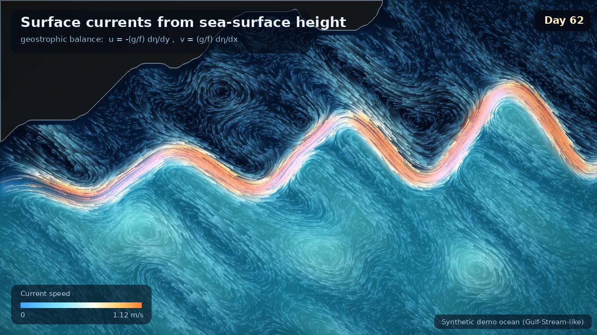
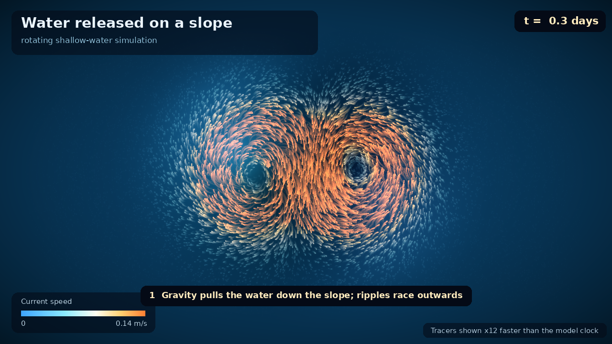
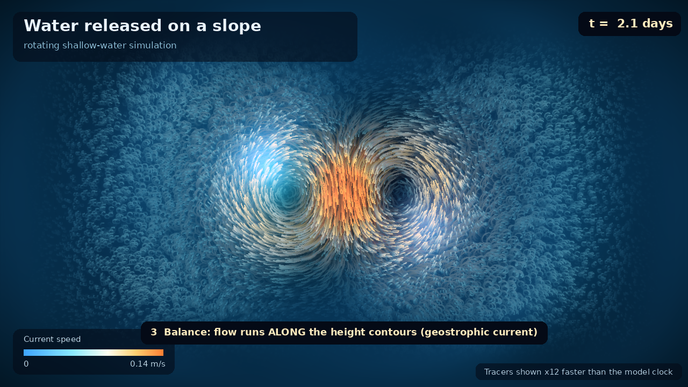
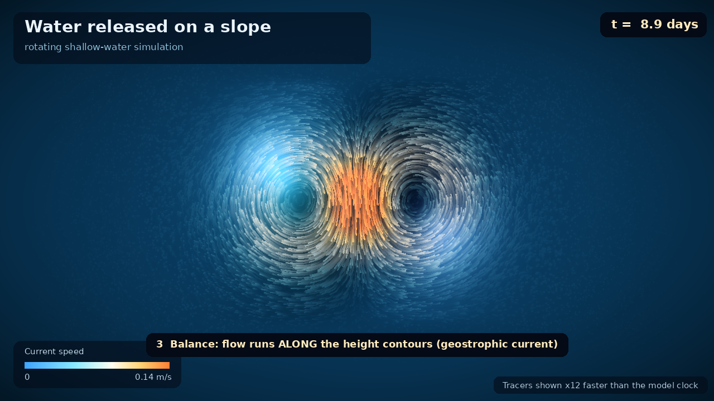

# Geostrophic Flow Simulation

Ocean surface currents calculated from sea-surface height, animated as flowing
water, plus a small physics simulation that shows **how** water on a slope ends
up in those currents.



| Water released on a slope (rotating shallow-water simulation) |
| --- |
|  |
|  |
|  |

Full videos: `media/surface_currents.mp4` and `media/slope_simulation.mp4`.

## The idea

Satellites measure the height of the sea surface (ADT). The ocean has hills and
hollows, and you might expect water to run downhill. It does, but only for a
moment. The Earth's rotation (the Coriolis force) turns the moving water
sideways until the downhill push and the sideways push balance. The current
then runs **along** the height contours instead of down them:

```
u = -(g / f) * d(eta)/dy        (eastward)
v =  (g / f) * d(eta)/dx        (northward)          f = 2 * Omega * sin(latitude)
```

This is geostrophic balance. In the Northern Hemisphere, high water is on the
right of the flow.

## What is in here

| File | What it does |
| --- | --- |
| `run_flow_video.py` | Animates tracer particles carried by the currents over a shaded water surface |
| `run_slope_simulation.py` | Rotating shallow-water simulation: water runs downhill, gets turned, settles into a geostrophic current |
| `run_analysis_figure.py` | Four-panel figure: height + streamlines, speed, Rossby number, transect |
| `geoflow/core.py` | Data loading, geostrophic velocity, vorticity, tracer advection (RK4) |
| `geoflow/shallow_water.py` | The shallow-water solver and a test against a textbook solution |
| `geoflow/render.py` | Water-surface shading, glowing trails, text overlay, video output |
| `tests/` | 18 tests (physics checks, not just "it runs") |
| `original/geostrophic_basic.py` | The first version, kept for reference |

## Setup

```
pip install -r requirements.txt
```

## Run it

```
python run_flow_video.py                      # built-in synthetic ocean, no data needed
python run_flow_video.py --file dataset.nc    # your DUACS / Copernicus file
python run_flow_video.py --file dataset.nc --bbox -80 -40 25 50    # crop: lon_min lon_max lat_min lat_max

python run_slope_simulation.py                # a hill next to a hollow
python run_slope_simulation.py --shape mound  # one hill (also: ridge)
python run_slope_simulation.py --check        # compare with theory, no video

python run_analysis_figure.py --file dataset.nc --time-index 10
python -m pytest
```

Videos go to `media/`. Add `--seconds 8` for a quicker test render.

### Using real data

The file needs an `adt` variable with `time`, `latitude` and `longitude`
(Copernicus Marine product SEALEVEL_GLO_PHY_L4). Descending latitude, missing
values and extra variables are handled. If the file also contains the official
`ugos`/`vgos` currents, the script prints how closely this code reproduces them.
If you only have `sla`, it still works, but it leaves out the mean flow and
prints a warning.

**Note:** the repo's demo videos use the built-in *synthetic* ocean (a made-up
Gulf-Stream-like jet with rings), because no real data file is included. The
code has been tested on a DUACS-format file written for the tests, but not on a
real Copernicus download yet.

## Checks

- Geostrophic velocity matches the exact answer for uniform slopes on the sphere.
- The velocity is perpendicular to the height gradient (flow along contours).
- The shallow-water simulation reproduces the textbook *Rossby adjustment*
  solution (Gill, 1982): height profile within 0.2%, peak jet speed within 5.4%.
  The speed error shrinks as the grid is refined (-16% at 5 km, -2% at 1.25 km),
  so it comes from resolution, not a bug.
- Energy is conserved to 0.02% over two days with no damping.
- After settling, the simulated flow matches `f v = g d(eta)/dx` to within 1%,
  averaged over one inertial oscillation (about 17.5 hours).

## What was fixed from the original notebook

| Problem | Fix |
| --- | --- |
| `np.gradient` was given a per-latitude `dx` as the column spacing | Derivatives are taken per degree and divided by `R cos(lat)` |
| `1/f` blows up near the equator | Cells within 5 degrees of the equator are masked |
| Land / missing values not handled | NaN is kept as land and masked in the plots |
| One time step, so nothing moved | Tracers are moved through every map in the file (RK4) |
| NetCDF engine error | Several backends are tried, with a clear message if none are installed |

## Limits to know about

- The shallow-water model is **linear** and uses one layer on an f-plane. It
  shows the adjustment process correctly but has no eddy-eddy interaction.
  Heights scale linearly, so the speeds shown are for the chosen amplitude.
- In the slope video, tracers are shown faster than the model clock (the factor
  is printed on screen) so their motion is visible.
- Geostrophy fails near the equator and near coasts. It ignores wind-driven and
  tidal currents.

## Possible next steps

- Nonlinear shallow-water equations (eddies that move each other)
- Wind-driven (Ekman) currents added on top
- Compare several dates or seasons side by side

## Publishing to GitHub

```
git init
git add .
git commit -m "Geostrophic flow simulation"
git branch -M main
git remote add origin https://github.com/<your-username>/geostrophic-flow-simulation.git
git push -u origin main
```

Keep `*.nc` files out of the repo (already in `.gitignore`).
